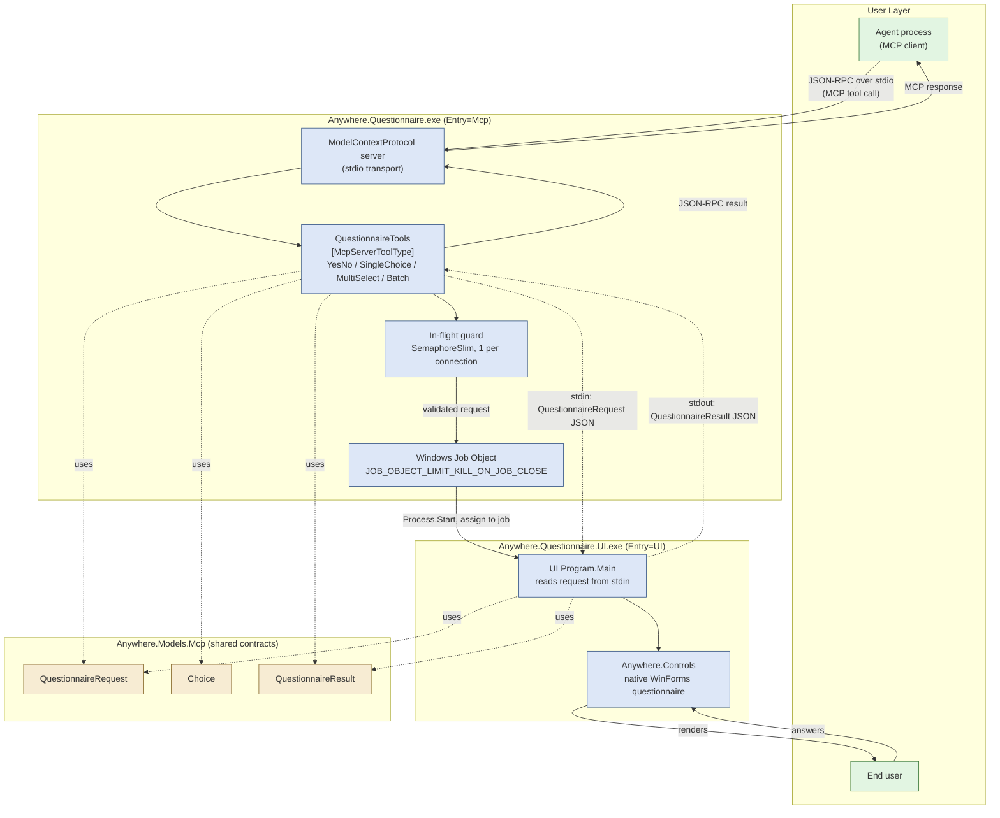

# Interactive Questionnaire MCP Architecture

Epic PRD: [epic.md](epic.md)

## Epic Architecture Overview

A single new project, `Anywhere.Questionnaire`, built twice with a conditional
`Entry` MSBuild property into two sibling self-contained executables sharing one
`bin`/publish output directory:

- **`Anywhere.Questionnaire.exe`** (`Entry=Mcp`): the MCP server. Hosts the
  official `ModelContextProtocol` SDK over stdio, no WinForms dependency. An
  agent launches it as a subprocess per `.mcp.json`.
- **`Anywhere.Questionnaire.UI.exe`** (`Entry=UI`): the standalone
  question-window host. References `Anywhere.Controls` (WinForms) and
  `Anywhere.Design`.

The MCP executable spawns the UI executable per questionnaire, writes the
request as JSON to its stdin, and reads the result as JSON from its stdout.
It ties the child's lifetime to its own via a Windows Job Object. Shared
framework-agnostic contracts (`QuestionnaireRequest`, `Choice`,
`QuestionnaireResult`, and their enums) live in `Anywhere.Models.Mcp`,
referenced by both executables, so neither depends on the other's SDK (MCP or
WinForms).

## System Architecture Diagram

## High-Level Features & Technical Enablers

### Features

- MCP tools for `YesNo`, `SingleChoice`, and `MultiSelect` questions, plus a
  batch tool accepting an array of questions.
- Native WinForms questionnaire window built on `Anywhere.Controls`, launched
  per request as its own process.
- Deterministic `Answered` / `Cancelled` result reporting back to the agent.

### Technical Enablers

- `Anywhere.Models.Mcp` namespace: `QuestionnaireRequest`, `Choice`,
  `QuestionnaireResult`, `QuestionKind`, `CompletionStatus`: plain POCOs, no
  MCP SDK or WinForms references, shared by both executables.
- `Anywhere.Questionnaire` project, dual-entry build (`Entry=Mcp` / `Entry=UI`)
  via conditional `StartupObject`/`AssemblyName`/`UseWindowsForms` in one
  `.csproj`, publishing both as self-contained single-file executables into
  one output directory.
- Stdio IPC between the two executables, mirroring the existing
  `src/Anywhere/Agents/AgentProcess.cs` subprocess pattern already used for
  ACP.
- Windows Job Object assignment (`JOB_OBJECT_LIMIT_KILL_ON_JOB_CLOSE`) so the
  UI child process is killed automatically if the MCP-entry parent exits for
  any reason.
- `SemaphoreSlim`-based in-flight guard in the MCP tool handlers, since MCP's
  JSON-RPC-over-stdio transport permits a client to pipeline a second request
  before the first resolves.
- Integration test project exercising the real published `Entry=Mcp`
  executable over `StdioClientTransport`/`McpClient` (official SDK client),
  mirroring the `FakeAgent` subprocess test pattern already used for
  `AgentProcess`.
- `.mcp.json` entry for local development: `dotnet run --project
  src/Anywhere.Questionnaire -p:Entry=Mcp` (flip to the published executable's
  path before distribution).

## Technology Stack

- .NET 10 (`net10.0-windows`), matching the rest of the solution.
- `ModelContextProtocol` 2.3.0 (official SDK), stdio transport.
- WinForms via `Anywhere.Controls` / `Anywhere.Design` (UI entry only).
- `System.Text.Json` for the stdin/stdout request/result payloads, same
  settings as the MCP SDK's own serialization.
- xUnit for integration tests, per the project's existing testing strategy.

## Technical Value

**High.** Reuses the existing `Anywhere.Controls` foundation and the
established subprocess/stdio pattern from `AgentProcess.cs`, instead of
inventing new mechanisms. The dual-entry single-project build keeps the MCP
server's dependency closure free of WinForms, while still sharing one
publish/output step with the UI host.

## T-Shirt Size Estimate

**M.** One new project (dual-entry), one new shared-contracts namespace, and
one integration test harness; no EF Core, no new persistence layer, no second
IPC mechanism beyond stdio the codebase already uses elsewhere.
